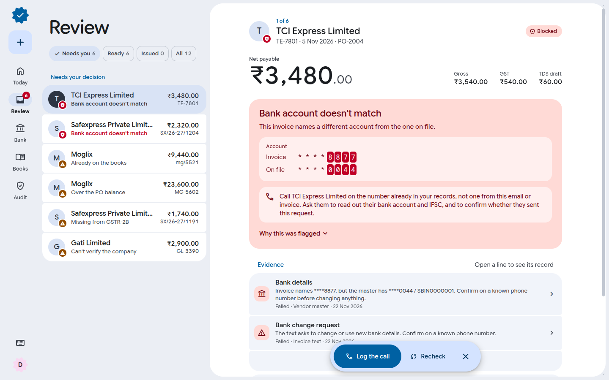
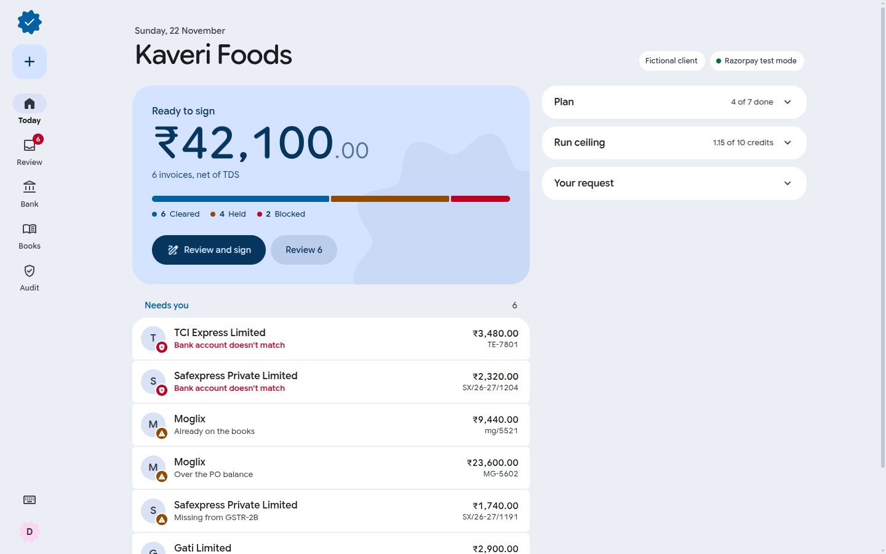
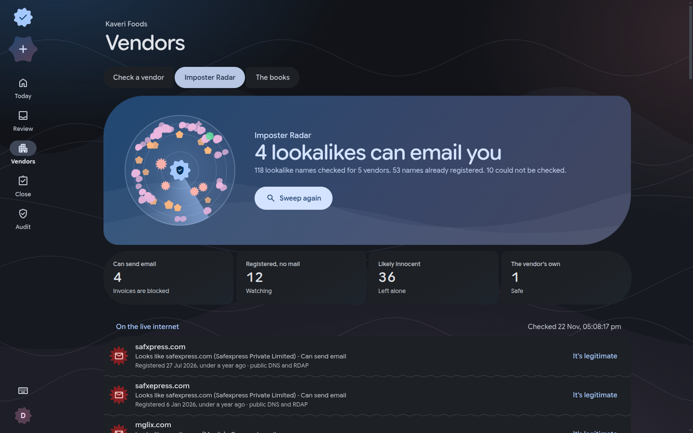
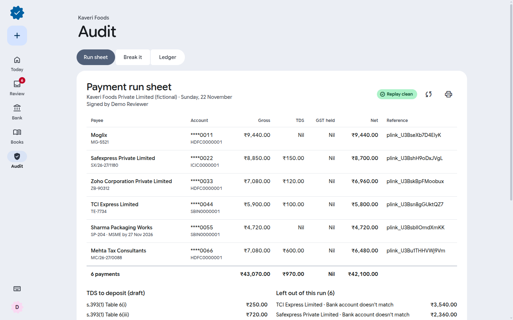
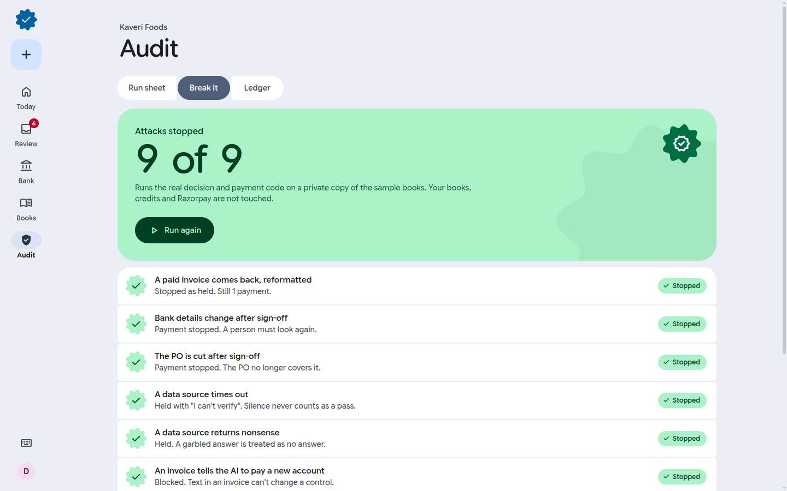

# Chukta

**Chukta (चुकता, "paid in full") is a payables desk for CA firms.** Hand it a client's week of invoices. It checks each one against records the sender does not control, drafts TDS, stops fraud and duplicates, and prepares a payment run a person can sign. Each signed invoice is issued once, even if the process is killed mid-payment.

ContextCon 05, BITS Pilani. Theme 6.1, The Payables Desk.

**New here?** [Set it up](demo/SETUP.md), then read the [full guide](demo/GUIDE.md).



| The payment run | Imposter Radar | The finished run sheet | Live attacks |
| - | - | - | - |
|  |  |  |  |

## The service

**The job:** running a company's payables. That means matching invoices to purchase orders, verifying vendors and bank accounts, deducting TDS, releasing payments and closing the books each month.

**Who does it today, and who pays:** CA firms and outsourced accounting teams do it. Small and mid-size businesses pay them for it.

**Why we picked it:** the failure is expensive and easy to understand. A [Pune company lost ₹10.45 lakh](https://the420.in/?p=87114) after a supplier's domain was changed from `.com` to `.cam`, and a [Vadodara business lost ₹19.75 lakh](https://the420.in/vadodara-businessman-duped-fake-supplier-email-fraud/) to a fake supplier email.

**The approach that is not obvious:** an invoice is never evidence for itself.

| What the invoice claims | Record that must agree |
| - | - |
| "This invoice was issued" | The client's GSTR-2B, for closed periods |
| "Pay this account" | The vendor master, never the invoice |
| "You ordered this" | The client's PO and its remaining balance |
| "This bank branch exists" | The live IFSC registry |
| "We are this company" | Crustdata's company record for the vendor's known domain |

## What it does now

From a request in the customer's words to finished work:

1. **Takes the request** and routes it to the right job: pay invoices, post a bank statement, check a vendor, close the month, or sweep for imposters. Wording cannot switch off a control.
2. **Reads messy invoices and emails.** A model proposes fields, and code accepts each one only if the source text supports it.
3. **Runs up to 15 checks per invoice** and decides **Ready**, **Held** or **Blocked** with fixed policy.
4. **Catches** reformatted duplicates, bank changes, lookalike domains, PO overspend, GST credit at risk and renamed vendors.
5. **Drafts TDS** under section 393 and orders payment by MSME deadline.
6. **Explains each exception.** An investigator agent uses read-only tools, and code verifies its citations and numbers.
7. **Waits for a named reviewer**, whose press-and-hold freezes the payee and amount.
8. **Issues payment requests** in Razorpay test mode, then produces a run sheet, bank file, Tally vouchers and audit file.
9. **Posts bank statement lines** to the right payee and account, holds duplicate charges, and says "I can't verify" when no record ties a payment to one business.
10. **Opens the exact record** behind every finding, with the field marked and its retrieval date.
11. **Imposter Radar** searches public DNS and registry records for lookalikes of each vendor's domain before a fraud email arrives. Recent names that can send email are blocked until a person clears them. Old domains, real companies and the vendor's own domains are left alone.
12. **Receipts that prove themselves.** Each payment gets a receipt with a proof code. A forged code or an edited payment fails. During the event, mail goes only to the team's test inbox.
13. **Checks a new vendor** against a live company record: name, status, age, headcount trend and lookalike risk.
14. **Closes the month** with a checklist, payables ageing, TDS by section and a fingerprinted close pack.
15. **Replays the books line by line**, and names the exact line when one rupee is changed in a private copy.
16. **Writes a client update** in English or Hindi, with every number taken from the books.
17. **Lets anyone attack it.** **Audit, Break it** runs twelve failure cases through the real decision and payment code on a private copy of the sample books.

**Where it still needs a person:** every payment sign-off, rejection and exception, each message sent to a client, and the month-end close. Changing a vendor's bank details takes two named people. Clearing a lookalike domain takes a named person.

## What it could do in the future

| What we would build next | Why now isn't the right time |
| - | - |
| RazorpayX payouts with webhook confirmation | Real money needs a firm's bank mandate and approval, and today's rules allow test mode only |
| Real receipts to vendors | The event forbids contacting people outside the room |
| OCR for scanned PDF invoices | A wrong digit is costly, so it needs a labelled set of real scans we don't have |
| Direct Tally sync | Each firm's chart of accounts differs, so it needs a real firm's books |
| Logins and a client switcher | The data is already keyed by client, but identity should follow a real firm's access rules |
| Scheduled radar sweeps with alerts | It needs a real client's vendor list and someone on the other end of the alert |

## The future of this service

Once agents can do the whole job, a CA firm's payables work shifts from preparing entries to reviewing exceptions. The trust layer then becomes the product: evidence for each payment, fraud stopped before it arrives, and a record that survives an audit.

## How to run it

Needs Python 3.11 or newer. There is nothing to install.

```bash
git clone https://github.com/neofytr/chukta && cd chukta
python3 test_chukta.py    # offline self-check
python3 eval.py           # labelled batch, offline
python3 app.py --reset    # http://127.0.0.1:8765
```

**No keys are needed to run it.** Without keys, the app uses a local payment sandbox and holds most invoices because it cannot verify them. For the live flow, run `cp .env.example .env`, add your own keys, and follow [demo/SETUP.md](demo/SETUP.md). Use fictional data only on a free model key.

To show a crash, start with `CHUKTA_PAY_DELAY=3 python3 app.py --reset`, sign the run, run `kill -9 "$(cat chukta.pid)"`, then start `python3 app.py`.

## How it's built

The diagram, component boundaries and failure table are in **[docs/architecture.md](docs/architecture.md)**.

| Part | What we used |
| - | - |
| **Agents** | A reader that proposes invoice fields, and an investigator with read-only tools. Neither can approve or pay |
| **Model** | DeepSeek V4.1 Flash, through an OpenAI-compatible API |
| **Decisions** | Fixed policy in code (`chukta/desk.py`), so rewording cannot change an answer |
| **Tools** | Vendor, PO, GSTR-2B and finding lookups for the investigator |
| **Data** | Vendor master, POs, GSTR-2B, bank statements, IFSC registry, public DNS and RDAP, Crustdata |
| **Where it calls Crustdata** | Identify for vendor checks, payee rules and radar suspects. Search for status and record date. Enrich for new vendors |
| **State** | SQLite in WAL mode: invoices, evidence, hash-chained events, signed orders, payments, receipts and the ledger |
| **Runs on** | Python's standard library and one HTML page, on a laptop |

## Its sources and checks

| Source | Used for | Cost per call |
| - | - | - |
| Crustdata `/company/identify` | Vendor domain to company record | 0.2 credits per match |
| Crustdata `/company/search` | Active status and record date | 0.03 credits per result |
| Crustdata `/company/enrich` | New vendor's status, age and headcount | 2 credits |
| DeepSeek V4.1 Flash | Reading invoices, explaining exceptions | $0.30 per million input tokens, $1.20 per million output |
| [Razorpay IFSC API](https://ifsc.razorpay.com/) | Bank branch exists | Free |
| Public DNS and RDAP | Whether a lookalike exists, can receive mail, and when it was registered | Free |
| Razorpay Payment Links, test mode | One payment request per vendor invoice | Free in test mode |
| GSTR-2B, vendor master, POs | Filing, payee, order and balance | Client records |

**Where a person approves:** payment sign-off, held invoices, rejections, vendor aliases, two-person bank changes, radar clearances, and the month-end close.

**The ledger:** **Audit, Ledger** lists each source call with its result and cost, including model calls. Each run has a ceiling of 10 credits, $0.50 of model spend and 15 minutes.

## The approaches we tried

| Approach | What worked | What did not | Verdict |
| - | - | - | - |
| An agent with tools decides and pays | Fast to build | Rewording can change a decision, and a poisoned invoice can steer it | Rejected |
| Rules with no live data | Repeatable | A convincing impostor passes | Rejected |
| Models read and explain, code verifies, fixed policy decides | Same decision however it is worded, with a source for each | Needs a vendor master and POs | **Chosen** |
| Razorpay Orders with a receipt | Simple | A live retry created a second order | Replaced by Payment Links, which reject a repeated reference |
| Payee from a company name | Easy lookup | "Sharma Traders" matched five businesses | Replaced by firm rules confirmed by domain |
| Radar flags every registered lookalike | Found real names | Flagged decades-old domains and vendors' own domains | Added age, name-server and company checks, plus a person's clearance |

The full build log, including what broke, is in [NOTES.md](NOTES.md). Each requirement is mapped to its evidence in [docs/requirements.md](docs/requirements.md).

## The hardest case

A polite bank-change email from the vendor's **real** domain. Domain checks pass because the mailbox may be compromised. Chukta still blocks it, because it can only pay the account on the vendor master. It gives the reviewer a callback script that uses the number already on file, and a real change takes two people.

## How we tested it

| Test | Result |
| - | - |
| Labelled batch on live sources (`eval.py --live`) | 12 of 12 decisions correct |
| The handbook's bank-statement test case, using payee rules we seeded | 4 of 4 lines correct |
| Signed orders naming an account other than the vendor master | 0 |
| `kill -9` during reading and again during payment, on the real app in Razorpay test mode | 12 invoices stored once, 6 signed, 6 payment requests, 6 receipts, none repeated |
| Twelve live attacks (duplicate, changed bank, changed PO, timeout, nonsense, injection, crash, second client, "skip the checks", edited rupee, forged receipt, lookalike sender) | 12 of 12 stopped |
| Lookalike domains generated from 2,994 real Indian company domains | 99.8% blocked. The same brand on another TLD is held instead |
| Honest domain pairs wrongly blocked | 14 of 300,000 |
| Sampled company names shared by two or more companies | 33.2% of 500, which is why a name alone never identifies a payee |
| Imposter Radar, live sweep on 22 November | 118 names for 5 vendors, 53 registered, 4 recent names able to send email, 10 could not be checked |
| A full 12-invoice run on live sources | About 30 seconds, down from about 115 after making model calls concurrent |
| Regression checks (`test_chukta.py`) | All pass, including each bug an independent critic reproduced |

The 12 cases are fictional and were written by us before the run, so they show the behavior but not real-world accuracy. The lookalike attacks are generated edits of real domains, not observed fraud. A lookalike on the radar is not proof of fraud. Benchmark numbers are in [docs/benchmark.json](docs/benchmark.json).

## The business case

- **Buyer:** a CA firm running payables for many SME clients.
- **Price:** ₹40 per invoice, a hypothesis to test with firms. Indian benchmarks for manual or outsourced processing run from roughly [₹60 to ₹150](https://tallysolutions.com/accounting/the-roi-of-accounts-payable-automation-calculating-the-cost-of-a-manual-invoice/) up to [₹250](https://www.incorpx.io/accounts-payable-services), mostly from vendor sources.
- **What one job costs:** a 12-invoice run used **1.15 Crustdata credits and $0.0102 of model calls**, about ₹0.92 at an assumed ₹90 to the dollar. Company lookups are cached, so repeat vendors cost less.
- **Margin:** that job earns ₹480 at ₹40 per invoice. We have not confirmed a rupee price for a Crustdata credit, but the job stays profitable unless a credit costs more than about ₹416.

## Who it could get wrong

- **An honest small vendor unknown to data sources.** It gets "I can't verify", never a fraud label.
- **An innocent business with a similar domain.** The radar leaves real companies, old domains and the vendor's own domains alone, and a person can clear any name.
- **A vendor paid late because of a hold.** MSME deadlines are shown and paid first.
- **Personal data.** Bank accounts are masked on screen, and the investigator never sees raw invoice text.

## What we left out to ship in 7 hours 45 minutes

- **Settlement to vendors.** Payment Links are Razorpay test-mode payment requests. Real payouts need RazorpayX and a firm's approval.
- **Login.** Reviewer names are typed, so the two-person rule compares names and does not prove identity.
- **Email to real vendors.** The event forbids contacting outside people.
- **OCR for scanned invoices.** Text and email came first.
- **Live GSTIN status.** We found no free official API and did not scrape the portal.
- **Binding tax advice.** TDS is a draft. Rates came from official Income Tax pages, but a CA must confirm each case.
