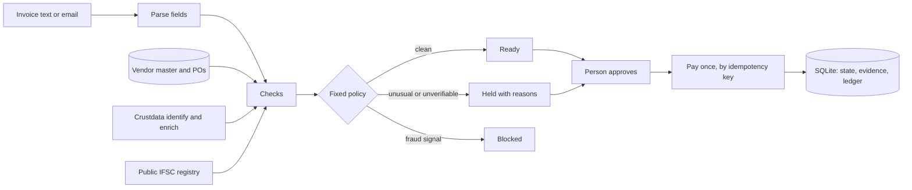

# Chukta: build plan

## The service

Outsourced accounting firms and in-house payables teams are paid to get invoices matched, checked and paid. The costliest failures are duplicate payments and a polite email that changes a vendor's bank details.

**Request:** "Here are this week's invoices from our accounts inbox. Match each one to its purchase order, check the vendor and its bank account, pay each one once, and hold anything unusual for my approval with the reason."

**Finished work:** every invoice is paid in test mode or held with cited reasons, and an auditor can replay the books line by line.

## Why this theme

| Theme | Fit | Verdict |
| - | - | - |
| 6.1 Payables Desk | Exercises exactly-once, crash resume, approval, fraud and citations. Few API calls per vendor | **Chosen** |
| 5.1 Vendor Check | Strong on live data, but stops at a report | Absorbed as one stage |
| 1.1 Search Desk | Needs many search and enrich calls, which 5 RPM makes slow | Rejected |
| 9.1 Outbound Desk | Its finished result needs real outreach, which the rules forbid | Rejected |

## Approaches considered

1. **LLM agent with tools decides and pays.** Quick to build, but wording can change the decision and a poisoned invoice can steer it. Rejected.
2. **Rules only, no live data.** Deterministic, but cannot catch a convincing fake vendor. Rejected.
3. **Deterministic gate over live evidence (chosen).** Parsing produces fields, independent sources produce evidence, and fixed policy decides. An LLM can later help read messy invoices, but it has no authority over money.

## Architecture

## Checks

| Check | Source | Outcome if it fails |
| - | - | - |
| Required fields present | Invoice | Hold, names the missing field |
| GSTIN checksum | Offline algorithm | Block |
| Vendor on master | Vendor master | Hold |
| Duplicate, across number formats | Invoice history | Hold |
| PO exists, same vendor, within balance | PO table | Hold |
| Bank account matches master | Vendor master | Block |
| IFSC exists | Razorpay public IFSC API | Block if absent, hold if the source is down |
| Sender domain matches, lookalike detection | Vendor master | Block on lookalike |
| Vendor domain resolves to the same company | Crustdata Identify | Hold as "I can't verify" |

## Timeline (IST)

| By | Goal |
| - | - |
| 11:30 | Core desk passes the offline self-check |
| 13:00 | One real request runs end to end on live data |
| 14:30 | **Checkpoint submission.** Hardest case tried |
| 15:30 | Review UI: queue, evidence, approve, ledger |
| 16:30 | Crash-and-resume demo, messy inputs, `judge` agent pass |
| 17:30 | README, diagram, 2-minute video |
| 18:00 | **Code freeze** |

## Left out on purpose

- Real bank rails: test mode only, by event rule.
- OCR of scanned PDFs: text invoices first.
- Multi-client tenancy: one company's books per database.

## Open inputs

- Razorpay test keys, otherwise payments stay in the local sandbox.
- A model API key, needed only for LLM reading of messy invoices.
- Price in rupees, to set from the measured cost per invoice.
