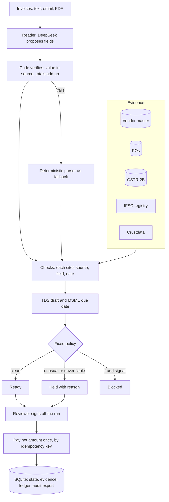

# Chukta: end-to-end plan

Theme 6.1, The Payables Desk. Solo build. Code freeze 6:00 PM IST, 22 Nov 2026.

## 0. Problem Statement update (read 10:50 AM). This overrides the sections below where they differ

**Binding changes**

- **One fictional client for all teams:** a mid-size Indian 3PL logistics company. Its name, records and requests come from the kickoff kit. Its counterparties are real companies. The CA-firm framing below is no longer the demo client.
- **Hidden test set:** organizers run the service on unseen requests, using the kit's input and output formats. A wrong answer costs more than "cannot verify".
- **Track scope:** pay each invoice exactly once through crashes and bank-detail fraud, and **reconcile or post bank-statement lines** (payee, account, duplicate hold, cannot verify).
- **Payments must run in a provider's test mode** such as Razorpay or Stripe. The local sandbox is a risk.
- **Requirement change at hour 3**, around 1:15 PM. Organizers may also change client records during the build.
- **Screening:** organizers stop and restart the service and inspect README, architecture diagram, logs, cost records and repo history.
- **Finals (100):** live run 20, robustness 15, design 15, ethics 25, financial feasibility 25. Includes a kill on stage, a 5-minute live fix and one system design question, in a 12-minute slot.
- **README must state:** the job and who pays today, input, finished result, pass mark, and each data source. The architecture diagram must live in the repo and show data calls, approvals, retries and the cost ledger.

**Conflicts with the handbook, to confirm with organizers**

| Topic | Handbook | Problem Statement |
| - | - | - |
| Repo | New public repo | Organizer repo received at kickoff |
| Scoring | Five criteria, execution 25 | Five different areas, ethics and finance 25 each |
| Finals slot | 2-minute demo, 1 minute of questions | 12-minute slot with live fix |

**Revised order, once the kit arrives**

1. Adapter for the kit's input and output formats, and a restartable runner.
2. Bank-line posting and payee resolution, with a real source per payee.
3. Provider test-mode payments.
4. Measured cost per job, and the ethics story: personal data, approvals, explanations.
5. Domain extras only if the kit's requests need them. TDS, MSME and GSTR-2B are paused until then.

## 1. The service

**Who pays today:** small and mid-size Indian businesses pay CA and outsourced accounting firms to run their payables.

**Customer:** a CA firm running payables for many clients. Chukta does the preparer's work, and the firm's reviewer only signs off on the payment run and the exceptions.

**Request:** "Here are this week's invoices for Kaveri Foods. Match each one to its PO, check the vendor and its bank account, work out TDS, pay each one once, and hold anything unusual for my approval with the reason."

**Finished work:** a signed-off payment run, paid once in the sandbox, with TDS drafted, MSME deadlines respected, GST credit at risk listed, each exception explained, and an audit file that replays every decision.

## 2. The idea

**An invoice is never evidence for itself.** Every fact that moves money must agree with a record the sender does not control.

| Claim on the invoice | Independent record |
| - | - |
| "This invoice was really issued" | Client's GSTR-2B, built from what the supplier filed with GST |
| "Pay this account" | Vendor master, never the invoice |
| "We ordered this" | Client's PO |
| "This branch code exists" | IFSC registry |
| "We are this company" | Crustdata company record, resolved from the vendor's known domain |
| "This came from the vendor" | Sender domain against the vendor master |

GSTR-2B is the non-obvious part. A CA firm already has it for every client, and a fraudster who copies a vendor's letterhead cannot put a matching invoice into it.

## 3. What research changed

| Finding | Evidence | Design consequence |
| - | - | - |
| Crustdata knows established Indian vendors | 16 of 16 real vendor domains matched | Identify stays in the core flow |
| Small-vendor coverage is untested | That sample skewed large. `sharmatraders.in` had no match | No match means "I can't verify", never "fake". Measure on smaller vendors in M5 |
| Names differ across records | `gati.com` resolves to Allcargo Logistics, `dtdc.in` to "DTDC Support" | Name matching alone would hold honest vendors. Add person-confirmed aliases, and show `all_domains` as evidence |
| My test domain is a real company | `acmetools.in` matched ACME Tools | Demo vendors must use reserved `.test` domains unless deliberately real |
| Enrich returns little by default | Without `fields`, only `basic_info` | Request `basic_info,headcount,locations,revenue` once per new vendor |
| Rate limit is 5 RPM | `GET /account/endpoints` | Batch identify, cache per vendor |
| No free official GSTIN status API found | Search found paid third-party APIs only. The portal is not to be scraped | Use GSTR-2B as the government record. Live status stays "I can't verify" |
| DeepSeek reads messy Hinglish invoices | All fields correct in a 2-second test, injection text flagged | Use it as the reader, then verify its output in code |
| Free LLM key may store requests | Model listing says only paid and partner requests are not stored | **Fictional data only.** Real client data needs a no-storage route |

## 4. Approaches

1. **An LLM agent decides and pays.** Fastest, but rewording can change a decision and a poisoned invoice can steer it. Rejected.
2. **Rules with no live data.** Repeatable, but a convincing impostor passes. Rejected.
3. **LLM reads, code verifies, fixed policy decides (chosen).** The model only proposes field values. Each must be found in the source text, totals must add up, and it has no route to approval or payment.

## 5. Architecture

Stack: Python 3.12 stdlib, SQLite in WAL mode, one static HTML page served by `http.server`. `pdftotext` handles text PDFs.

## 6. Build order

| By | Milestone | Done when |
| - | - | - |
| 11:30 | **M1 Reader and clients:** `client_id` on all records, DeepSeek reader with verification, aliases | Messy invoices parse. A wrong model value is rejected in a test |
| 12:30 | **M2 Compliance:** GSTR-2B import and match, MSME due dates, TDS draft, net payment | Each has a passing test |
| 13:00 | **M3 One real request:** CLI runs a full batch on live data | Batch goes from request to sandbox payment |
| 14:30 | **M4 Reviewer screen:** queue, evidence, sign-off, ledger. **Checkpoint submission** | You can run the demo in a browser |
| 15:30 | **M5 Evaluation:** labelled batch, restart mid-run, source failures | Score table generated by a script |
| 16:30 | **M6 Audit:** replay export, `fact-auditor` and `judge` passes, top fixes | Audit file reproduces every decision |
| 17:15 | **M7 Submission pack:** README, diagram, fresh-clone test | Runs from a clean clone |
| 17:45 | Record and upload the 2-minute video | Plays in a private window |
| 17:55 | **Final submission** | Before the 6:00 PM freeze |

If time slips, cut in this order: PDF intake, enrich details in the UI, GST credit-risk totals. Never cut approval, exactly-once payment, citations or the evaluation.

## 7. Evaluation set

A labelled batch of fictional invoices dated after 1 Sep 2026, two clients, with the expected decision recorded before running.

| Case | Expected |
| - | - |
| Clean invoice, in 2B | Ready |
| Same invoice as `INV-0042`, `inv/42` | Held, cannot be approved |
| Same amount and date, new number | Held |
| Bank change from lookalike domain | Blocked |
| Bank change from the real domain (compromised mailbox) | Blocked |
| Valid-looking invoice missing from a filed 2B period | Held |
| Current-period invoice, 2B not out yet | Not treated as a failure, GST credit marked pending |
| Over PO balance | Held |
| Same invoice number at two clients | Both proceed, no cross-client match |
| Renamed vendor | Held once, passes after a person confirms the alias |
| Vendor unknown to Crustdata | "I can't verify" |
| Messy Hinglish invoice | Same decision as its clean twin |
| Injection text in invoice | No effect on decision |
| MSME invoice near deadline | Prioritised with due date |
| TDS threshold edge | Draft correct, needs confirmation |
| Crustdata, IFSC or LLM down | Held or fallback, never passed |
| Process killed before and after payment | One payment |

## 8. Business case

- Benchmarks for manual or outsourced processing run about ₹60 to ₹250 per invoice, mostly from vendor sources, so treat them as rough.
- **Proposed price: ₹40 per invoice**, a hypothesis to test with CA firms.
- Measured so far: one LLM read used 360 tokens, about $0.0002. Crustdata costs 0.2 credits per vendor to identify and 2 to enrich, cached across invoices. M5 reports the real cost per invoice.

## 9. Risks to check

- TDS rates come from practitioner tables. Confirm against an official Section 393 chart in M2, and keep every TDS figure a draft.
- Section 43B(h) scope (enterprise size and traders) must be confirmed from an official source in M2.
- The GSTR-2B file schema is from memory. Check it against a real export if you can get one. Otherwise import a documented subset.
- The DeepSeek route showed `is_ready: false` but answered. The regex parser is the fallback if it drops.

## 10. Left out

- Real bank rails and Razorpay. Payments use the local sandbox, chosen for reliability today.
- OCR for scanned invoices.
- Real email ingestion, because agents must stay in the room.
- Live GSTIN status, until a paid verification API is added.

## 11. Your tasks

- Now: `! gh auth login` as `neofytr`.
- 2:30 PM: submit the checkpoint form.
- 5:15 PM: record the video from the script I prepare.
- By 5:55 PM: final submission, with your details on the member page.

## Sources

- [Tally: cost of a manual invoice in India](https://tallysolutions.com/accounting/the-roi-of-accounts-payable-automation-calculating-the-cost-of-a-manual-invoice/)
- [IncorpX: AP services](https://www.incorpx.io/accounts-payable-services)
- [The420: Vadodara supplier email fraud, ₹19.75 lakh](https://the420.in/vadodara-businessman-duped-fake-supplier-email-fraud/)
- [The420: Pune .com to .cam fraud, ₹10.45 lakh](https://the420.in/?p=87114)
- [CFO.com on APQC duplicate and erroneous payments](https://www.cfo.com/news/metric-of-the-month-detect-and-prevent-duplicate-or-erroneous-payments/)
- [ClearTax: Section 43B(h)](https://cleartax.in/s/section-43bh-of-income-tax-act)
- [Income Tax Department: Section 393](https://www.incometaxindia.gov.in/w/section-393-6)
- [TaxGuru: TDS under the Income-tax Act, 2025](https://taxguru.in/income-tax/tds-rates-income-tax-act-2025.html)
- [ClearTax: supplier not filed GSTR-1](https://cleartax.in/s/supplier-not-filed-gstr-1)
- [Cashfree: GSTIN verification](https://www.cashfree.com/docs/secure-id/know-your-business/verify-gstin.md)
- [Razorpay: payout idempotency](https://razorpay.com/docs/api/x/payout-idempotency/)
