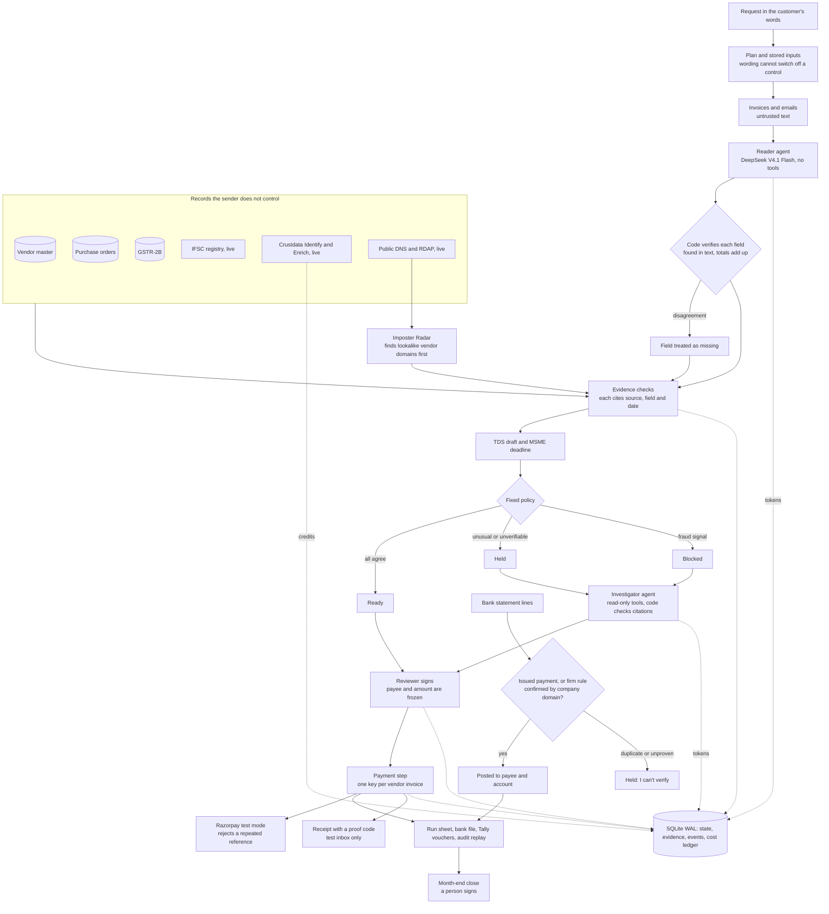

# How Chukta is built

**The invariant:** money moves only for an invoice a named person approved, to the account on the vendor master, at most once per vendor invoice. No model output or invoice text can change this.

## Components

| Component | Owns | Why it is separate |
| - | - | - |
| Runs (`chukta/runs.py`) | The request, the plan, stored inputs, ceilings | A crash must lose nothing |
| Reader (`chukta/reader.py`) | Proposed fields | A model can be wrong or poisoned |
| Sources (`chukta/sources.py`) | Throttling, retries, cache, cost ledger | External failure domain |
| Desk (`chukta/desk.py`) | Checks, policy, state, payment | The only code that changes state |
| Investigator (`chukta/investigator.py`) | Explanations and recommended next step | Useful judgment with no authority |
| Razorpay (`chukta/razorpay.py`) | Provider calls | Refuses live keys |
| Statement (`chukta/statement.py`) | Bank-line posting | A name alone never proves a payee |
| Records (`chukta/records.py`) | The exact record behind each finding | Every claim must be checkable |
| Exports (`chukta/exports.py`) | Bank file, vouchers, audit replay | Finished work for the firm |

## State machine

`NEW -> READY | HELD | BLOCKED -> APPROVED -> PAID`, or `-> REJECTED`. Every transition is a guarded update in one SQLite transaction.

## What happens when things fail

| Failure | Behavior |
| - | - |
| Model down or wrong | Rule-based parser, and any disagreement holds the invoice |
| Crustdata or IFSC down | Held as "I can't verify", tried once per run |
| Run reaches its credit or time limit | Remaining checks hold |
| Process killed while reading | Inputs are stored first, and restart continues from the next invoice |
| Process killed before payment | Invoice stays `APPROVED`, and restart resumes the open run |
| Process killed after the provider call | Restart repeats the same reference, and Razorpay returns the first payment |
| Provider rate limit or outage | Waits or stays `APPROVED` for another try |
| Provider refuses the payment | Held for a person, nothing created |

## At 100 times the volume

The first limit is Crustdata's 5 requests per minute on this key. Each call already batches 25 domains and caches per vendor, so cost grows with new vendors rather than invoices. Next steps would be Postgres with row locks, a job queue per client, and a provider webhook to confirm settlement. A second client is already isolated by `client_id` in every key.

## Flows added later

| Module | Job | Failure behaviour |
| - | - | - |
| `chukta/radar.py` | Finds registered lookalikes of vendor domains through DNS, RDAP and Crustdata | A failed lookup is "could not be checked", never safe |
| `chukta/receipts.py` | Issues a receipt with an HMAC proof code for each payment | Claimed before sending. A crash mid-send is marked unclear and never resent |
| `chukta/vendorcheck.py` | Checks a new vendor against a live company record | A failed source returns "I can't verify" |
| `chukta/close.py` | Month-end checklist and fingerprinted close pack | Cannot be signed while any check is open |
| `chukta/brief.py` | Client update in English or Hindi | A draft for a person to send |
| `chukta/exports.py` | Line-by-line replay and tamper demo | Tampering runs on an in-memory copy only |
